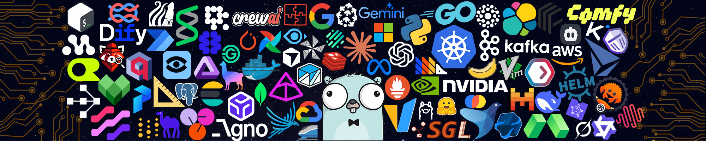

  <!-- Banner Image -->
  

  <h1>👋 Hi, I'm Ahmed Hossam El-Khashab</h1>
  <h3><b>Machine Learning Systems & GenAI Engineer</b></h3>

  

    Specialized in engineering foundation model infrastructure, <b>Agentic RAG Workflows</b>, and high-performance AI systems.
  

  <!-- Badges -->
  

    
    
    
    
  

  I am a research-oriented <b>Machine Learning Systems & GenAI Engineer</b> working on foundation model infrastructure, alignment, and evaluation. I build efficient and reliable systems for large language models while studying the algorithms and data choices that make them more useful, controllable, and cost-effective in real applications.

## 🔬 Core Research & Engineering Interests

- 🎯 **Model-System Co-Design:** Understanding how model architecture, inference algorithms, data curation, hardware utilization, scheduling, and distributed runtimes interact.
- 🤖 **Agentic RAG & LLM Orchestration:** Designing multi-agent systems using `LangGraph`, hybrid vector search (`FAISS` + `BM25`), and neural reranking (`BGE`).
- ⚡ **Production & Backend:** Deploying scalable AI solutions with `FastAPI`, asynchronous runtimes, and optimized pipelines.

 

## 🛠️ Tech Stack & Architecture

<table>
  <tr>
    <td align="center" width="25%"><b>AI & LLM Ecosystem</b></td>
    <td width="75%">
      <code>LangChain</code> • <code>LangGraph</code> • <code>FAISS</code> • <code>BM25</code> • <code>Sentence-Transformers</code> • <code>BGE Reranker</code> • <code>Ollama</code> • <code>Groq API</code> • <code>Gemini API</code>
    </td>
  </tr>
  <tr>
    <td align="center"><b>Backend & Core</b></td>
    <td>
      <code>Python 3.12/3.13</code> • <code>FastAPI</code> • <code>Gradio</code> • <code>RESTful APIs</code> • <code>C++</code>
    </td>
  </tr>
  <tr>
    <td align="center"><b>Hardware & IoT</b></td>
    <td>
      <code>ESP32</code> • <code>Arduino UNO</code> • <code>IoT Sensors</code> • <code>Edge Integration</code>
    </td>
  </tr>
  <tr>
    <td align="center"><b>Toolchain & DevOps</b></td>
    <td>
      <code>Docker Desktop</code> • <code>Git / GitHub</code> • <code>Google Colab</code> • <code>VS Code</code> • <code>PowerShell</code>
    </td>
  </tr>
</table>

 

## 🌟 Featured Projects

  <table width="100%">
    <tr>
      <td width="50%" valign="top">
        <h3>🤖 BNU Smart Assistant</h3>
        
A sophisticated bilingual Arabic/English academic AI platform driven by <b>Agentic RAG</b>, hybrid vector search, BGE neural reranking, and dynamic state graphs via <code>LangGraph</code>.

        
<code>LangGraph</code> <code>FAISS</code> <code>FastAPI</code> <code>LLMs</code>

      </td>
      <td width="50%" valign="top">
        <h3>🪴 Smart Automated Irrigation System</h3>
        
An IoT-driven environmental control framework utilizing microcontroller integration, multiplexers, and real-time sensory thresholds for automated resource management.

        
<code>Arduino</code> <code>C++</code> <code>IoT Sensors</code>

      </td>
    </tr>
  </table>

 

## 📊 GitHub Stats

  
  

 

  Engineered with precision by <b>Ahmed Hossam El-Khashab</b>

